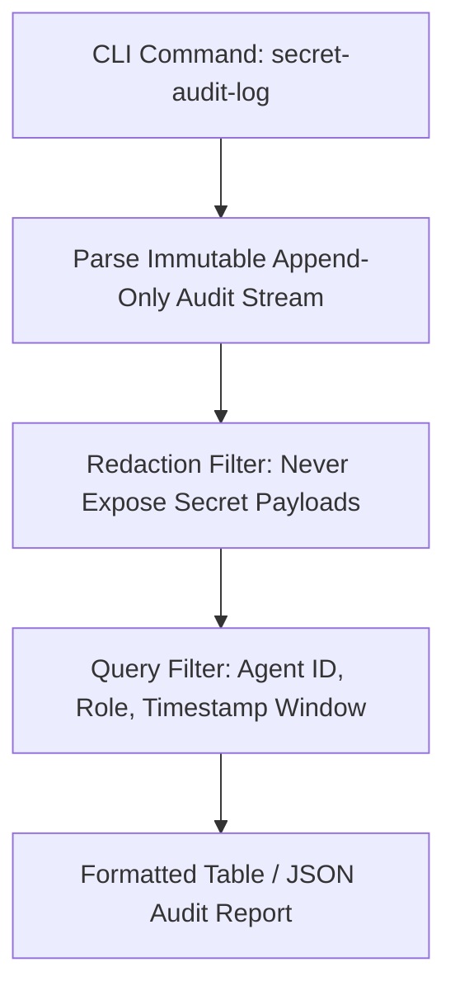

<p align="center"><a href="https://kitsunetechnologies.org/work"></a></p>

# Secret Ledger

View audit logs of secret access without printing the secrets themselves.

[](https://github.com/KitsuneTech1/secret-audit-log/actions)
[](LICENSE) 

## Quick Start

Install Python 3 (included with most systems). Then read a log file:

```bash
python secret_audit_log.py audit.log
```

Output a JSON array instead of a table:

```bash
python secret_audit_log.py audit.log --format json
```

Filter by keyword and show only the last 5 events:

```bash
python secret_audit_log.py audit.log --filter timeout --limit 5
```

## How It Works

The tool reads access metadata and prints a table or JSON. Each log entry captures when a secret was accessed, which tool accessed it, the secret name, and the reason.

Output contains only four fields: timestamp, tool, secret name, and reason. The `secret` field is the name only, never the value. This tool does not attempt to fetch, resolve, or hide values that ended up in a log by mistake.

## Requirements

Python 3 and the standard library. No external dependencies.

## Log Format

The tool accepts three formats:

**JSON array** (each entry has timestamp, tool, secret name, and reason):

```json
[
  {
    "timestamp": "2026-10-31T10:00:00Z",
    "tool": "my-app",
    "secret": "db_password",
    "reason": "initialize connection"
  }
]
```

**Wrapped in an entries object:**

```json
{
  "entries": [
    {
      "timestamp": "2026-10-31T10:00:00Z",
      "tool": "my-app",
      "secret": "db_password",
      "reason": "initialize connection"
    }
  ]
}
```

**JSON Lines** (one entry per line):

```
{"timestamp":"2026-10-31T10:00:00Z","tool":"my-app","secret":"db_password","reason":"initialize connection"}
{"timestamp":"2026-10-31T10:05:00Z","tool":"other","secret":"api_key","reason":"external call"}
```

Blank lines in JSON Lines format are skipped. All entries must have non-empty string values for `timestamp`, `tool`, `secret`, and `reason`. Timestamps must be ISO 8601 format. Files larger than 16 MiB are rejected.

## Options

`--format {table,json}` - Output as table (default) or JSON array.

`--filter TEXT` - Show only entries where tool, secret name, or reason contains TEXT (case-insensitive).

`--limit N` - Show only the last N entries. Use `--limit 0` to show none.

The command exits with status 0 on success, status 1 if the log cannot be read or is malformed, and status 2 for invalid arguments.

## Testing

```bash
python -m unittest -v
```

The tests use local temporary files only. They do not make network requests.


## Architecture & Data Flow



## License

MIT. Copyright (c) 2026 Kitsune Technologies LLC. Do what you like with it, commercially or otherwise, just keep the copyright notice. Full text in [LICENSE](LICENSE).

---

<p align="center"><sub>Part of <b>Buildtober 2026</b>: 31 open source projects in 31 days. Built by <a href="https://kitsunetechnologies.org/work">Kitsune Technologies</a>. More at <a href="https://github.com/KitsuneTech1">github.com/KitsuneTech1</a>.</sub></p>
